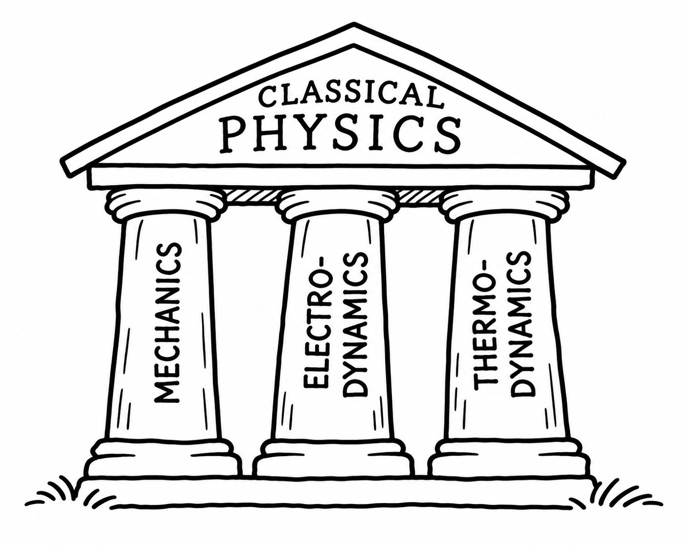
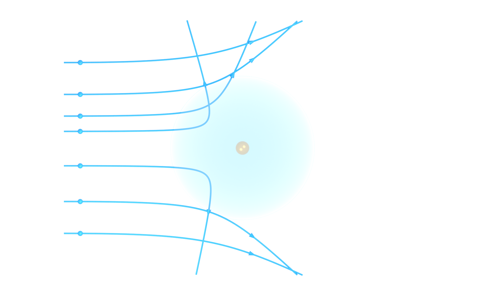
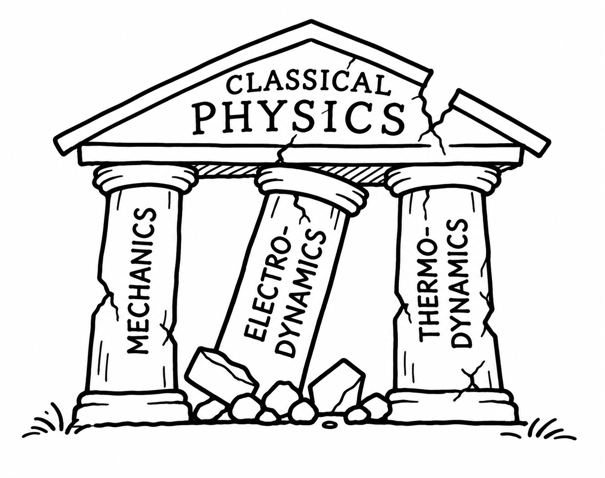

---
filters:
- ../physics-macros.lua
format:
  html:
    css: ../styles.css
    fig-alt: true
subtitle: How a few small wrinkles changed our view of nature
title: 1 From Classical Physics to the Quantum World of Atoms
---

# A world without quantum mechanics

Why does the wire in a toaster glow orange when it gets hot? Why do
atoms not simply collapse? Why can molecules form stable structures, and
why are solids *solid*?

These questions sound very different. Yet all of them have something in
common: they cannot be answered within classical physics alone.

Quantum mechanics is sometimes introduced through its strangest
consequences---particles that behave like waves, probabilities instead
of definite outcomes, or states that can exist in superposition. But
quantum mechanics is not merely an exotic theory for phenomena far
removed from everyday experience. It explains the stability and
structure of ordinary matter.

Modern technology also depends on it. The controlled motion of electrons
in semiconductor devices makes computers and smartphones possible.
Lasers and light-emitting diodes rely on transitions between quantum
states. Much of modern medical imaging, photovoltaics, and countless
other technologies ultimately depend on our ability to understand and
manipulate matter at the quantum level.

How did physicists arrive at such a radically different description of
nature?

To understand that, it is useful to go back to a time **before quantum
mechanics existed**---to a period when the foundations of physics seemed
remarkably secure.

# 1878: Physics is almost complete

Imagine Munich in **1878**. A young student, about twenty years old, has
begun studying physics at the university. His name is **Max Planck**.

Planck asks one of his teachers, **Philipp von Jolly**, about the
prospects of pursuing physics. Jolly is an established experimental
physicist, nearly seventy years old. Looking back many years later,
Planck recalled the advice he received: physics appeared to be a highly
developed, nearly mature science. Its basic structure seemed secure;
what remained was largely a matter of filling in details.


:::: {.columns}

::: {.column width="50%"}

{target="_blank" rel="noopener noreferrer"}, public domain.](Max_Planck_1878_cropped.png){fig-alt="Historical portrait photograph of the young Max Planck in 1878." width="70%" fig-align="center"}

:::

::: {.column width="50%"}

{target="_blank" rel="noopener noreferrer"}, public domain.](Philipp_von_Jolly.webp){fig-alt="Historical portrait drawing of physicist Philipp von Jolly." width="70%" fig-align="center"}

:::

::::


::: {.callout-note title="Planck's recollection"}
Writing in 1933, Planck recalled the advice Philipp von Jolly had given him when he began his university studies:

> “As I began my university studies I asked my venerable teacher Philipp von Jolly for advice regarding the conditions and prospects of my chosen field of study. He described physics to me as a highly developed, nearly fully matured science, that through the crowning achievement of the discovery of the principle of conservation of energy it will arguably soon take its final stable form. It may yet keep going in one corner or another, scrutinizing or putting in order a jot here and a tittle there, but the system as a whole is secured, and theoretical physics is noticeably approaching its completion to the same degree as geometry did centuries ago. That was the view fifty years ago of a respected physicist at the time.”

**Source:** Max Planck, *Wege zur physikalischen Erkenntnis: Reden und Vorträge*  
(S. Hirzel, Leipzig, 1933), p. 128.  
[Digitized German original at the TIB](https://goobi.tib.eu/viewer/toc/1667547127/)
:::

From today's perspective this sounds almost comically premature. Within
only a few decades, **relativity** and **quantum theory** would
transform the foundations of physics.

But dismissing Jolly's assessment would be too easy. To understand why
such confidence was possible, we should first appreciate just how
successful nineteenth-century physics had become.

# The triumph of classical physics

By the end of the nineteenth century, much of physics could be organized
around three extraordinarily successful theoretical frameworks:

1.  **Mechanics** --- the motion of matter,
2.  **Electrodynamics** --- electricity, magnetism, and light,
3.  **Thermodynamics and statistical mechanics** --- heat, energy, and
    the collective behavior of matter.


{#fig-classical-pillars fig-alt="An intact classical Greek temple labeled Classical Physics, supported by three columns representing mechanics, electrodynamics, and thermodynamics." width="85%" fig-align="center"}


## Mechanics: predicting motion

The development of what we now call **classical mechanics** was closely
tied to one of humanity's oldest scientific problems: understanding the
motion of objects in the sky.

In the early seventeenth century, **Galileo Galilei** used the newly
developed telescope to observe, among other things, moons orbiting
Jupiter. **Johannes Kepler**, using the exceptionally precise
astronomical observations of Tycho Brahe, discovered that the planets
travel around the Sun on elliptical orbits.

The decisive theoretical step came with **Isaac Newton**. In his
*Philosophiæ Naturalis Principia Mathematica*, published in 1687, Newton
provided a general framework connecting forces and motion. In modern
notation, his second law is written

$$
\vec F = m\vec a,
$$

while the gravitational attraction between two masses is

$$
F = G\frac{mM}{r^2}.
$$

The same mechanics that describes a falling object on Earth also
explains the motion of the Moon and the planets. Terrestrial and
celestial physics had become part of a single framework.


:::: {.columns}

::: {.column width="50%"}

.jpg){target="_blank" rel="noopener noreferrer"}, public domain.](Newton_1689.webp){fig-alt="Portrait of Isaac Newton with long, curled hair, wearing a dark robe over a white shirt." width="75%" fig-align="center"}

:::

::: {.column width="50%"}

{target="_blank" rel="noopener noreferrer"}, public domain.](Principia_1687.webp){fig-alt="Title page of the 1687 first edition of Newton's Principia Mathematica, featuring its Latin title and historical publication information." width="75%" fig-align="center"}

:::

::::


Newton's formulation was only the beginning. During the eighteenth and nineteenth centuries, physicists and mathematicians developed increasingly powerful and general formulations of mechanics.

**Joseph-Louis Lagrange** recast mechanics in terms of generalized coordinates and the principle of stationary action. For a system described by coordinates $q_i$, the equations of motion can be written as

$$
\frac{d}{dt}\left(\frac{\partial L}{\partial \dot q_i}\right)
-
\frac{\partial L}{\partial q_i}
=0,
$$

where $L$ is the Lagrangian.

A further reformulation was developed by **William Rowan Hamilton**. Instead of describing a system in terms of coordinates and velocities, Hamiltonian mechanics uses coordinates $q_i$ and their conjugate momenta $p_i$. The central quantity is the **Hamiltonian**

$$
H(q_i,p_i,t),
$$

which, for many familiar systems, corresponds to the total energy.

Hamilton's equations,

$$
\dot q_i=\frac{\partial H}{\partial p_i},
\qquad
\dot p_i=-\frac{\partial H}{\partial q_i},
$$

provide yet another compact and very general way of describing classical motion.

::: {.callout-note title="A name that will return"}
The Hamiltonian will become one of the central objects in quantum mechanics. There it is promoted from a classical function to an operator that governs the dynamics of a quantum system.
:::

We do not need the details of either formulation here. The important point is the extraordinary **generality** of classical mechanics. Given the laws governing a system and its initial state, its subsequent motion is determined.

Classical mechanics could describe falling objects, projectiles, pendulums, gyroscopes, planetary systems, and much more. There were puzzles---most famously the small anomalous precession of Mercury's orbit---but the successes were overwhelming.

Its practical reach was just as impressive. Classical mechanics underpinned engineering, machine design, ballistics, navigation, and increasingly precise astronomy. The same mathematical framework could be used to design a bridge, predict the trajectory of a projectile, or calculate the orbit of a planet.


## Electrodynamics: one theory for many phenomena

The nineteenth century also transformed the understanding of electricity and magnetism.

At first, phenomena such as **electrostatic forces**, **electric currents**, **magnetism**, and **electromagnetic induction** looked like different subjects. Experiments by **Coulomb, Gauss, Ampère, Faraday**, and many others gradually revealed that they were deeply connected.

A stationary electric charge produces an electric field. Electric currents produce magnetic fields. Changing magnetic fields can induce electric currents. Electricity and magnetism were not independent phenomena.

Then, in 1865, the Scottish physicist **James Clerk Maxwell** published *A Dynamical Theory of the Electromagnetic Field*. Maxwell brought these discoveries together and completed the theoretical framework.

In modern notation, Maxwell's equations are

$$
\nabla\cdot\vec E = \frac{\rho}{\epsilon_0},
\qquad
\nabla\cdot\vec B = 0,
$$

$$
\nabla\times\vec E = -\frac{\partial\vec B}{\partial t},
\qquad
\nabla\times\vec B =
\mu_0\left(
\vec j+\epsilon_0\frac{\partial\vec E}{\partial t}
\right).
$$


The profound achievement was not simply that Maxwell found a compact set of equations. A **single theory** now described phenomena that had previously belonged to different areas of physics.

And the unification went even further.

In empty space, where there are no charges or currents, Maxwell's equations imply a wave equation. For example,

$$
\nabla^2\vec E
-
\frac{1}{c^2}
\frac{\partial^2\vec E}{\partial t^2}
=0.
$$

The propagation speed predicted by the theory is

$$
c=\frac{1}{\sqrt{\mu_0\epsilon_0}}.
$$

The remarkable point was that this speed agreed with the measured speed of light.

Maxwell concluded that **light itself is an electromagnetic wave**.

Electricity, magnetism, and optics---once treated as different subjects---were now part of the same theory.

The story did not end with visible light. In the late 1880s, **Heinrich Hertz** produced and detected electromagnetic waves in the laboratory at frequencies far below visible light, confirming Maxwell's prediction experimentally.

What we now call **radio waves** and visible light are not fundamentally different phenomena. They are different frequency ranges of the same electromagnetic field.

This was not merely an abstract theoretical triumph. Electromagnetism was also beginning to reshape everyday life and industry.

Generators converted mechanical motion into electrical energy. Electric motors did the reverse. Transformers and alternating-current systems made it possible to distribute electrical power over large distances. Electric lighting began to replace gas lighting in streets, factories, and homes. Telegraphy and telephony transformed long-distance communication, and the later development of radio extended communication into the wireless domain.

Inventors and engineers such as **Nikola Tesla** played an important role in developing practical alternating-current motors, polyphase power systems, transformers, and high-frequency electrical technology.


For someone entering physics around 1878, the lesson was difficult to miss:

> **Electromagnetism was not only explaining nature. It was unifying apparently unrelated phenomena and transforming the technological world at the same time.**


{target="_blank" rel="noopener noreferrer"}, public domain.](Yablochkov_candles_illuminating_Avenue_de_l'Opera_ca1878.jpg){fig-alt="Historical illustration of the Avenue de l'Opéra in Paris at night, illuminated by electric arc lamps, with pedestrians and horse-drawn carriages along the street." width="80%" fig-align="center"}


## Thermodynamics: from steam engines to atoms

The third pillar was **thermodynamics**, the study of heat, work,
temperature, and energy.

Its development had an intensely practical motivation. During the
Industrial Revolution, understanding heat was essential for improving
steam engines---the machines that powered factories, mines, locomotives,
and ships. But the effort to understand and improve these engines led to
laws of remarkable universality.

.jpg){target="_blank" rel="noopener noreferrer"} (no known copyright restrictions).](Machinery_Hall_S._Ave_(18677488953).jpg){fig-alt="Stereoscopic photograph consisting of two side-by-side views of the interior of Machinery Hall at the 1876 Philadelphia Centennial Exhibition. The large exhibition space contains numerous industrial machines beneath a high roof supported by iron trusses." width="90%" fig-align="center"}

In 1865, **Rudolf Clausius** summarized two central principles in
memorable form:

> The energy of the universe is constant.\
> The entropy of the universe tends to a maximum.

In modern terminology, the first statement expresses conservation of
energy; the second captures the irreversibility of macroscopic processes---why many processes naturally proceed in one direction but not in reverse.

But an even deeper question remained:

**What are temperature, pressure, and entropy actually telling us about
matter?**

The emerging **kinetic theory of gases** supplied an answer. A gas is
made from enormous numbers of microscopic particles in continual motion.
Pressure results from their collisions with the walls of a container.
Temperature is related to their average kinetic energy.

For an ideal monatomic gas,

$$
\left\langle E_\mathrm{kin}\right\rangle
=
\frac{3}{2}k_\mathrm{B}T.
$$

This was a remarkable change in perspective. Quantities such as
temperature and pressure, which appear to describe matter as a whole,
could emerge from the ordinary mechanical motion of microscopic
particles.


What made the emerging **statistical mechanics** especially profound was
that it did not require a new microscopic law of motion. The particles
were still assumed to obey ordinary classical mechanics. No new force
analogous to Newton's gravitational law, Coulomb's law, or Faraday's law
had to be introduced.

The new ingredient was instead **statistical reasoning**.

A macroscopic sample contains an enormous number of particles---typically
on the order of $10^{23}$. Following every microscopic trajectory is
impossible in practice, but it is also unnecessary. Probability theory,
combinatorics, and the mathematics of large numbers make it possible to
extract reliable predictions for the collective behavior of the system.

In this sense, statistical mechanics occupies a somewhat unusual place
among physical theories: rather than adding a new law governing the
microscopic world, it shows how qualitatively new macroscopic behavior
can emerge when the laws of mechanics are applied to very large numbers
of particles.

**Ludwig Boltzmann** pushed this statistical interpretation much
further. His famous relation

$$
S=k_\mathrm{B}\ln W
$$

connects the entropy $S$ of a macroscopic state to the number $W$ of
microscopic configurations compatible with it.


The significance is difficult to overstate. Entropy had entered
thermodynamics as a macroscopic quantity associated with heat and the
direction of thermodynamic processes. Boltzmann connected it to the
**number of microscopic ways in which the same macroscopic state can be
realized**.

Thermodynamics therefore began to look less like an independent set of
phenomenological laws and more like something that could emerge from
**mechanics plus statistics**.

This microscopic interpretation was controversial. The existence of
atoms was not yet universally accepted. Boltzmann and other **atomists**
treated matter as composed of microscopic particles, while opponents
favored descriptions in terms of continuous matter and energy.

There is also an important subtlety in the word *probability*.

Statistical mechanics uses probabilities, but in the classical picture
these probabilities did **not** necessarily mean that nature itself was
fundamentally random. Each microscopic particle was still assumed to
follow deterministic equations of motion. If one somehow knew the exact
positions and momenta of every particle, classical mechanics would, in
principle, determine their future motion.

Probability entered because no observer could realistically specify and
follow the microscopic state of something like $10^{23}$ particles.

In that sense, classical statistical mechanics was compatible with a
fully deterministic universe. Its probabilities could be understood as
describing our incomplete knowledge of an underlying mechanical
reality---not as a fundamental indeterminacy in nature itself.


# A clockwork universe

Put the pieces together.

Mechanics described matter and motion. Electrodynamics described
electric and magnetic fields---and light. Thermodynamics and statistical
mechanics connected the microscopic motion of matter to heat and
macroscopic behavior.

The resulting picture was not merely successful. It suggested a
particular **philosophy of nature**.

The fundamental equations of mechanics and electrodynamics are
deterministic. Specify the state of a system at one instant and, in
principle, its future is fixed by the equations of motion.

Chance need not be fundamental. Apparent randomness could simply reflect
our ignorance of the exact initial conditions or our inability to follow
an enormous number of particles.

More than half a century before Planck entered university,
**Pierre-Simon Laplace** had expressed this ideal in especially striking
language. He imagined an intellect that knew, at one instant, every
force and every position in nature. With unlimited ability to analyze
that information, such an intellect could know both past and future.

This hypothetical intellect later became known as **Laplace's demon**.


::: {.callout-tip title="The classical picture"}
At the end of the nineteenth century, it was reasonable to imagine
nature as an enormous clockwork:

-   matter consists of particles following definite trajectories,
-   light is an electromagnetic wave,
-   physical systems evolve according to deterministic equations,
-   statistical uncertainty reflects incomplete knowledge rather than
    fundamental randomness.

It was a remarkably coherent picture---and an extraordinarily successful
one.
:::


Seen from 1878, the confidence of physicists such as Jolly becomes easier to understand.

Classical mechanics had unified terrestrial and celestial motion. Electrodynamics had brought electricity, magnetism, induction, light, and eventually radio waves into one framework while powering a rapidly expanding electrical technology. Thermodynamics and statistical mechanics were beginning to connect heat and macroscopic behavior to microscopic motion.

Physics was not only explaining more and more of nature---it was doing so through theories of striking unity and practical power. Mechanics supported engineering and navigation; thermodynamics grew alongside the steam-powered industrial world; and electromagnetism was producing electric power, lighting, motors, and new forms of communication.

Max Planck was therefore not discouraged by the suggestion that the foundations of physics were essentially complete. He wanted to study physics because he wanted to understand nature.

That decision turned out to be fortunate.

Because there were a few **small wrinkles** in the classical picture.

And one of them would eventually occupy Planck himself.

# Small wrinkles

A successful physical theory should agree with observations, make
testable predictions, and remain internally consistent. Classical
physics passed these tests spectacularly across an enormous range of
phenomena.

But not everywhere.

Toward the end of the nineteenth century and the beginning of the
twentieth, several experimental results became increasingly difficult to
reconcile with the classical picture.

At first, these problems did not necessarily look like signs that an
entirely new mechanics of nature was needed. They were problems to be
solved---perhaps missing details in an otherwise successful framework.

They turned out to be much more than that.


## Wrinkle 1: How does a hot object glow?

Heat a piece of metal and it begins to glow. At first it appears dull
red. As its temperature increases, the emitted light becomes brighter
and shifts toward shorter wavelengths.

This is **thermal radiation**.

A particularly useful idealization is a **black body**: an object that
absorbs all incident radiation and whose emitted spectrum depends only
on its temperature.

By the late nineteenth century, the spectrum could be measured
accurately. The challenge was to explain its shape.

In 1896, **Wilhelm Wien** found a distribution law that described the high-frequency, short-wavelength side of the spectrum remarkably well. Wien's work was an important theoretical and phenomenological success, but it did not amount to a complete derivation of the observed spectrum from the established foundations of classical physics.

**Lord Rayleigh** attacked the problem in a more direct and, in a sense, more fundamental way: he tried to reconcile **Maxwell's electrodynamics** with **classical thermodynamics and statistical mechanics**.

Electromagnetic radiation inside a cavity can be decomposed into standing-wave modes. Maxwell's theory tells us which electromagnetic modes are possible; classical statistical mechanics then tells us how thermal energy should be distributed among them. Through the equipartition theorem, each mode receives an average energy of order $k_\mathrm{B}T$.

The number of electromagnetic modes available between frequencies $\nu$ and $\nu+d\nu$ increases as $\nu^2$. Combining mode counting with equipartition leads to the Rayleigh--Jeans result

$$
u(\nu,T)
=
\frac{8\pi\nu^2}{c^3}k_\mathrm{B}T.
$$

At low frequencies, this agrees well with experiment.

At high frequencies, however, it becomes absurd: the predicted energy density grows without limit as $\nu$ increases. Integrating over all frequencies would imply an infinite amount of radiated energy.

This failure became known as the **ultraviolet catastrophe**.


```{python}
#| label: fig-blackbody-radiation
#| fig-cap: "Blackbody radiation at the Sun's effective temperature (5772 K). Comparison of Planck's radiation law, Wien's radiation law, and the classical Rayleigh–Jeans law with the extraterrestrial solar spectrum (AM0). The logarithmic scale highlights the deviations between the theoretical predictions. Solar data: ASTM G173 reference spectrum (NREL)."
#| fig-alt: "Logarithmic plot of spectral irradiance versus frequency from 0.01 to 1.0 PHz. Planck's law agrees approximately with the measured extraterrestrial solar spectrum. Wien's law falls below Planck's prediction at low frequencies, while the classical Rayleigh–Jeans law increasingly overestimates the radiation at high frequencies."
#| fig-width: 8
#| fig-height: 5
#| fig-align: center

import numpy as np
import matplotlib.pyplot as plt
from scipy.constants import h, c, k
from pvlib import spectrum

# Solar parameters
T = 5772  # K
R_sun = 6.957e8  # m
AU = 1.495978707e11  # m

omega_sun = np.pi * (R_sun / AU)**2

# Frequency axis in PHz
frequency_phz = np.linspace(0.03, 3.0, 3000)
nu = frequency_phz * 1e15

x = h * nu / (k * T)

# Spectral irradiance per PHz, W/(m² PHz)
conversion = omega_sun * 1e15

planck = conversion * (2 * h * nu**3 / c**2) / np.expm1(x)
wien = conversion * (2 * h * nu**3 / c**2) * np.exp(-x)
rayleigh_jeans = conversion * 2 * nu**2 * k * T / c**2

# ASTM G173 extraterrestrial solar spectrum
solar = spectrum.get_reference_spectra()

solar_lam_nm = solar.index.to_numpy()
solar_lam_m = solar_lam_nm * 1e-9
solar_frequency_phz = c / solar_lam_m / 1e15

# Convert W/(m² nm) to W/(m² PHz)
solar_am0 = (
    solar["extraterrestrial"].to_numpy()
    * 1e9 * solar_lam_m**2 / c * 1e15
)

# Plot
fig, ax = plt.subplots(figsize=(8, 5))

ax.plot(frequency_phz, planck, label="Planck", lw=2)
ax.plot(frequency_phz, wien, label="Wien", ls="--", lw=1.8)
ax.plot(
    frequency_phz, rayleigh_jeans,
    label="Rayleigh–Jeans", ls=":", lw=1.8
)
ax.plot(
    solar_frequency_phz, solar_am0,
    label="Solar spectrum (AM0)",
    color="black", lw=0.8, alpha=0.65
)

ax.set(
    xlim=(0.01, 1.0),
    ylim=(1e2, 1e5),
    xlabel="Frequency (PHz)",
    ylabel=r"Spectral irradiance (W m$^{-2}$ PHz$^{-1}$)",
    title="Blackbody radiation and the solar spectrum"
)

ax.set_yscale("log")
ax.grid(alpha=0.2)
ax.legend(fontsize=9)

plt.show()
```


This was a particularly disturbing kind of failure.

Rayleigh had not used an obviously crude or inappropriate model. He had simply brought together **electrodynamics** and **statistical mechanics**---two theories whose success had helped create the confidence that classical physics was nearing completion.

And together, they predicted something impossible.

And now Max Planck returns to our story.

In 1900, Planck was searching for a formula that could reproduce the full measured spectrum and connect the regimes in which the existing descriptions worked.

The result was

$$u(\nu,T)
=
\frac{8\pi h\nu^3}{c^3}
\frac{1}{e^{h\nu/k_\mathrm{B}T}-1}.
$$

To obtain it, Planck introduced an assumption that did not fit comfortably into classical physics: the oscillators exchanging energy with the electromagnetic field could possess energies only in discrete steps,

$$
E_n=nh\nu,
\qquad n=0,1,2,\ldots
$$

where $h$ is a new fundamental constant---today called **Planck's constant**.

Planck's law reproduced the entire thermal spectrum, including both the low- and high-frequency limits.

The wrinkle had been repaired.

Or so it might have seemed.

::: {.callout-important title="A small mathematical fix?"}
The crucial step was the appearance of a discrete energy scale,
$E=h\nu$.

At first, this did not yet amount to the fully developed quantum
mechanics we use today. But the idea that energy exchange might be
fundamentally discrete was a sharp break with classical expectations.
:::

## Wrinkle 2: What is light?

Maxwell's theory had given one of the great triumphs of
nineteenth-century physics:

> Light is an electromagnetic wave.

Interference, diffraction, and polarization all strongly support its
wave character.

And yet another experiment was becoming difficult to understand.

When light strikes certain materials, electrons can be emitted from the
surface. This is the **photoelectric effect**.

```{python}


#| label: fig-photoelectric-nickel
#| fig-cap: "Photoelectric effect: (a) photocell with an adjustable bias and current meter; (b) illustrative stopping-potential measurements for nickel (work function 5.15 eV). The dashed segment is an unmeasurable extrapolation."
#| fig-alt: "Left: angled light waves strike a cathode, emitting scattered electrons toward an anode. A variable DC bias is applied and an ammeter measures photocurrent. Right: stopping potential versus frequency for nickel; black illustrative data follow a rising straight line above the 1.25 PHz threshold, with a short dashed extrapolation below zero."
#| fig-width: 12
#| fig-height: 5.5
#| fig-align: center

import numpy as np
import matplotlib.pyplot as plt
from matplotlib.patches import Circle, Rectangle, FancyBboxPatch
from scipy.constants import h, e

fig, (ax, bx) = plt.subplots(
    1, 2, figsize=(12, 5.5),
    gridspec_kw={"width_ratios": [1.2, 1]},
    constrained_layout=True
)

# -----------------------------------------------------
# LEFT: Photoelectric measurement
# -----------------------------------------------------

ax.set(xlim=(0, 10), ylim=(0, 9))
ax.set_aspect("equal")
ax.axis("off")
ax.set_title("(a) Photoelectric measurement")

# Evacuated photocell
ax.add_patch(FancyBboxPatch(
    (.8, 3.15), 8.5, 3.55,
    boxstyle="round,pad=.12,rounding_size=.5",
    ec=".4", fc="#f7fafc", lw=1.5
))

# Electrodes
ax.add_patch(Rectangle(
    (1.8, 3.65), .22, 2.3, color="steelblue"
))
ax.add_patch(Rectangle(
    (8.25, 3.65), .22, 2.3, color="darkorange"
))

ax.text(1.9, 3.36, "Cathode", ha="center", fontsize=10)
ax.text(8.35, 3.36, "Anode", ha="center", fontsize=10)
ax.text(
    6.2, 6.35, "Evacuated photocell",
    ha="center", color=".4"
)

# Incident waves directed toward the emitting face
d = np.array([-.75, -.66])
n = np.array([.66, -.75])
cshift = np.array([-.66, -.75])

for offset in [-.23, 0, .23, .46]:
    end = np.array([2.13, 5.17]) + offset * n
    start = end - 2.6 * d

    t = np.linspace(0, 1, 300)
    pts = (
        start + offset * cshift
        + (end - start) * t[:, None]
        + .065 * np.sin(12 * np.pi * t)[:, None] * n
    )

    ax.plot(
        pts[:, 0], pts[:, 1],
        color="#bf8b19", lw=1.5
    )

    ax.annotate(
        "", xy=end + offset * cshift - np.array([.1, .1]), xytext=pts[-14],
        arrowprops=dict(
            arrowstyle="-|>",
            color="#bf8b19", lw=1.6
        )
    )

ax.text(
    4.1, 7.5,
    r"Incident light, frequency $\nu$",
    ha="center", color="#9c6c0b"
)

# Photoelectrons with slightly different directions
rng = np.random.default_rng(7)

positions = [
    (2.7, 4.05),
    (3.25, 5.5),
    (3.9, 4.6),
    (4.65, 5.05),
    (5.3, 3.95),
    (5.9, 5.65),
    (6.65, 4.45),
    (7.35, 5.2)
]

for x, y in positions:
    ax.add_patch(Circle(
        (x, y), .105,
        fc="#389b77",
        ec="#216c52",
        zorder=4
    ))

    theta = rng.uniform(-.22, .22)

    ax.annotate(
        "",
        xy=(x + .57, y + .57 * np.tan(theta)),
        xytext=(x + .13, y),
        arrowprops=dict(
            arrowstyle="->",
            color="#287c60",
            lw=1.4
        )
    )

ax.text(
    5.2, 5.95, "Photoelectrons",
    color="#287c60", ha="center"
)

# Electrical circuit
wire = dict(color=".25", lw=1.5)

ax.plot(
    [1.91, 1.91, 3.05],
    [3.15, 1.2, 1.2], **wire
)
ax.plot(
    [8.36, 8.36, 7.25],
    [3.15, 1.2, 1.2], **wire
)

# Adjustable DC voltage source
ax.plot([3.05, 3.50], [1.2, 1.2], **wire)

ax.add_patch(Circle(
    (4.0, 1.2), .5,
    fill=False, lw=1.5
))

ax.text(
    4.0, 1.35, "+",
    ha="center", va="center", fontsize=12
)
ax.text(
    4.0, 1.03, "−",
    ha="center", va="center", fontsize=12
)

ax.annotate(
    "",
    xy=(4.42, 1.55),
    xytext=(3.57, .82),
    arrowprops=dict(arrowstyle="->", lw=1.3)
)

ax.plot([4.5, 5.65], [1.2, 1.2], **wire)

# Ammeter
ax.add_patch(Circle(
    (6.15, 1.2), .45,
    fill=False, lw=1.5
))
ax.text(
    6.15, 1.2, "A",
    ha="center", va="center", fontsize=12
)

ax.plot([6.60, 7.25], [1.2, 1.2], **wire)

ax.text(
    4, .15,
    "Applied variable DC bias\n(polarity reversible)",
    ha="center", fontsize=9
)
ax.text(
    6.25, 1.85,
    "Measured current $I$",
    ha="center", fontsize=9
)

# -----------------------------------------------------
# RIGHT: Stopping potential versus frequency
# -----------------------------------------------------

# Illustrative nickel work function
phi = 5.15  # eV

# h/e converted to V/PHz
slope = h / e * 1e15

# Threshold frequency
nu0 = phi / slope

nu = np.linspace(0, 4.6, 400)
vs = slope * nu - phi

# Physical region
ax2 = bx

ax2.plot(
    nu[nu >= nu0],
    vs[nu >= nu0],
    lw=2.4,
    label="Einstein relation"
)

# Dashed extrapolation below threshold
mask = (nu >= .085) & (nu < nu0)

ax2.plot(
    nu[mask], vs[mask],
    "--", color="tab:blue", lw=1.5,
    label="Extrapolation (not measured)"
)

# Synthetic illustrative measurements
nu_data = np.array([
    1.34, 1.49, 1.65, 1.81,
    2.01, 2.19, 2.39
])

noise = np.random.default_rng(19).normal(
    0, .11, len(nu_data)
)

ax2.scatter(
    nu_data,
    slope * nu_data - phi + noise,
    color=".15", s=32,
    zorder=5,
    label="Illustrative data"
)

# Threshold and zero line
ax2.axhline(0, color=".3", lw=.9)
ax2.axvline(nu0, ls=":", color=".55", lw=1)

ax2.annotate(
    fr"$\nu_0={nu0:.2f}\ \mathrm{{PHz}}$",
    xy=(nu0, 0),
    xytext=(1.62, .65),
    arrowprops=dict(arrowstyle="->")
)

ax2.set(
    xlim=(0, 5.15),
    ylim=(-5.5, 16.35),
    xlabel="Light frequency (PHz)",
    ylabel=r"Stopping potential $V_s$ (V)",
    title=r"(b) Nickel ($\Phi\approx5.15$ eV)"
)

ax2.grid(alpha=.2)
ax2.legend(loc="upper left", fontsize=8.5)

plt.show()

```

Classically, one might expect the energy transferred by a wave to depend
primarily on its intensity. But the experiments instead revealed a
decisive role for **frequency**.

In 1905, **Albert Einstein** took Planck's energy relation seriously in
a new way. He proposed that the electromagnetic field itself could
exchange energy in localized quanta with

$$
E_\gamma=h\nu.
$$

For the photoelectric effect,

$$
K_\mathrm{max}=h\nu-\Phi,
$$

where $\Phi$ is the work function of the material.

Increasing the light intensity increases the number of emitted
electrons, but their maximum kinetic energy is controlled by the
frequency.

A theory famous for establishing that light is a wave now had to coexist
with experiments in which light behaved as though its energy arrived in
discrete packets.

What, then, **is** light?

Planck had introduced discreteness in the exchange of energy between matter and radiation. Einstein had gone further and attached the quantum $h\nu$ to light itself. The next clues came from the other side of the interaction: **matter**, and atoms in particular, also seemed to permit only very specific energies.

## Wrinkle 3: What is an atom?

There was another difficulty---one even more directly connected to the
subject of this course.

What is matter made of?

By the end of the nineteenth century, experiments had begun to reveal
internal structure inside what had once been regarded as indivisible
atoms. In 1897, **J. J. Thomson** identified the electron as a
negatively charged constituent of matter.

If atoms are electrically neutral, positive charge must be present as
well. But how are the positive and negative charges arranged?

Thomson proposed a model in which the positive charge was distributed
throughout the atom, with electrons embedded within it.

Experiments by **Hans Geiger and Ernest Marsden**, under the direction
of **Ernest Rutherford**, provided a dramatic test. Alpha particles were
directed at a thin metal foil.

Most passed through with relatively small deflections.

But a tiny fraction scattered through surprisingly large angles.


::: {#fig-rutherford layout-ncol=2}

{width=100% fig-alt="Alpha particles scattering from a gold nucleus surrounded by a schematic electron cloud."}

```{python}
#| echo: true
#| fig-width: 7
#| fig-height: 5
#| fig-align: center
#| fig-alt: "Logarithmic plot of the Rutherford differential scattering cross section for 5 MeV alpha particles on gold versus scattering angle from 0 to 180 degrees. The theoretical cross section decreases steeply with increasing angle, while simulated measurements with Poisson error bars follow the predicted curve."

import numpy as np
import matplotlib.pyplot as plt
from scipy.constants import epsilon_0, elementary_charge

# Physical parameters
Z_alpha = 2
Z_gold = 79
E_MeV = 5.0

E = E_MeV * 1e6 * elementary_charge

# Rutherford differential cross section
def rutherford(theta_deg):
    theta = np.deg2rad(theta_deg)
    prefactor = (
        Z_alpha * Z_gold * elementary_charge**2
        / (16 * np.pi * epsilon_0 * E)
    )**2

    # Convert m^2/sr to barn/sr
    return prefactor / np.sin(theta / 2)**4 / 1e-28

# Theoretical curve
theta = np.linspace(10, 180, 600)
sigma = rutherford(theta)

fig, ax = plt.subplots(figsize=(7, 5))

ax.plot(
    theta, sigma,
    color="#1765a5",
    linewidth=2.4,
    label="Rutherford theory"
)

# Simulated experimental measurements
rng = np.random.default_rng(4343)

theta_points = np.array(
    [20, 30, 40, 50, 60, 75, 90, 110, 130, 150, 170]
)

sigma_true = rutherford(theta_points)

# Effective exposure in counts per (barn/sr)
exposure = 25.0

expected_counts = exposure * sigma_true
counts = rng.poisson(expected_counts)

sigma_measured = counts / exposure
sigma_error = np.sqrt(counts) / exposure

ax.errorbar(
    theta_points,
    sigma_measured,
    yerr=sigma_error,
    fmt="o",
    markersize=5,
    markerfacecolor="white",
    markeredgecolor="#b04a30",
    ecolor="#b04a30",
    color="#b04a30",
    capsize=3,
    linewidth=1.2,
    zorder=4,
    label="Simulated measurements"
)

# Plot formatting
ax.set_yscale("log")
ax.set_xlim(0, 180)
ax.set_xticks(np.arange(20, 181, 20))

ax.set_xlabel(r"Scattering angle $\theta$ (degrees)")
ax.set_ylabel(r"$d\sigma/d\Omega$ (barn/sr)")

ax.grid(True, which="major", alpha=0.22)
ax.grid(True, which="minor", alpha=0.10)
ax.legend(frameon=False)

plt.tight_layout()
plt.show()
```

Rutherford scattering. **Left:** Schematic visualization of alpha particles scattered by a gold nucleus, with the electron cloud and enlarged nucleus shown for illustration (not to scale). **Right:** Differential scattering cross section for 5 MeV alpha particles incident on gold. The solid line shows Rutherford theory; the points are simulated measurements with Poisson counting uncertainties.

:::


In 1911, Rutherford interpreted the results as evidence that nearly all
of the positive charge---and most of the mass---of an atom is
concentrated in an extremely small **nucleus**.

The atom was mostly empty space.

That was a remarkable discovery.

It also created a serious problem.

If negatively charged electrons orbit a positive nucleus like planets
orbiting the Sun, classical electrodynamics says that an accelerating
charge should radiate electromagnetic energy. The electron should lose
energy and spiral into the nucleus.

A classical planetary atom should therefore be unstable.

But atoms are stable.


## Wrinkle 4: Why do atoms have colors?

Atoms presented another clue.

Excite a gas---for example in an electrical discharge---and analyze the
emitted light with a prism or diffraction grating. Instead of producing
a continuous rainbow, an atomic gas emits light only at particular
wavelengths.

Each element has a characteristic **line spectrum**.

```{python}
#| echo: true
#| fig-width: 10
#| fig-height: 2.5
#| fig-align: center
#| fig-cap: "Visible emission spectrum of neutral lithium (Li I), based on observed wavelengths and relative line intensities from the NIST Atomic Spectra Database. Line brightnesses have been adjusted to enhance the visibility of weaker transitions."
#| fig-alt: "Visible emission spectrum of neutral lithium, showing weak violet, blue, and cyan lines, a prominent orange line near 610 nm, and a dominant red line near 671 nm."

import numpy as np
import matplotlib.pyplot as plt
from matplotlib.colors import to_rgb

# Li I observed air wavelengths (nm) and relative intensities
# Source: NIST Atomic Spectra Database
# Fine-structure components are grouped where unresolved.
lines = np.array([
    [413.259, 120],   # 413.256, 413.262, 413.262
    [427.310,  40],   # 427.307, 427.313
    [460.287,  39],   # 460.283, 460.289, 460.289
    [497.171,  16],   # 497.166, 497.175
    [610.360, 640],   # 610.354, 610.365
    [670.784, 7200],  # 670.776, 670.791
])

wavelengths = lines[:, 0]
intensities = lines[:, 1]

# Compress the dynamic range to make weaker lines visible
gamma = 0.30
brightness = (intensities / intensities.max()) ** gamma


def wavelength_to_rgb(wavelength):
    """Approximate visible-light color for wavelength in nm."""
    w = float(wavelength)

    if 380 <= w < 440:
        r, g, b = -(w - 440) / 60, 0, 1
    elif 440 <= w < 490:
        r, g, b = 0, (w - 440) / 50, 1
    elif 490 <= w < 510:
        r, g, b = 0, 1, -(w - 510) / 20
    elif 510 <= w < 580:
        r, g, b = (w - 510) / 70, 1, 0
    elif 580 <= w < 645:
        r, g, b = 1, -(w - 645) / 65, 0
    elif 645 <= w <= 780:
        r, g, b = 1, 0, 0
    else:
        return (0, 0, 0)

    # Approximate reduction in sensitivity at spectrum edges
    if w < 420:
        factor = 0.3 + 0.7 * (w - 380) / 40
    elif w > 700:
        factor = 0.3 + 0.7 * (780 - w) / 80
    else:
        factor = 1.0

    return tuple(factor * c for c in (r, g, b))


# Figure and spectrum strip
fig, ax = plt.subplots(figsize=(10, 2.5))
fig.patch.set_facecolor("white")
ax.set_facecolor("black")

# Draw each line using a broad translucent glow and sharp core
for wavelength, intensity in zip(wavelengths, brightness):
    color = np.array(wavelength_to_rgb(wavelength))
    color = np.clip(color * intensity, 0, 1)

    # Broad, faint glow
    ax.axvline(
        wavelength,
        color=color,
        linewidth=11,
        alpha=0.10,
        zorder=1
    )

    # Intermediate glow
    ax.axvline(
        wavelength,
        color=color,
        linewidth=5,
        alpha=0.35,
        zorder=2
    )

    # Bright narrow line
    ax.axvline(
        wavelength,
        color=color,
        linewidth=2.2,
        alpha=1.0,
        zorder=3
    )

ax.set_xlim(390, 750)
ax.set_ylim(0, 1)
ax.set_yticks([])
ax.set_xticks(np.arange(400, 751, 50))
ax.set_xlabel("Wavelength (nm)", fontsize=11)

# Put wavelength ticks below the black strip
ax.tick_params(axis="x", colors="black", length=4)
ax.xaxis.label.set_color("black")

# Hide unnecessary spines
for spine in ax.spines.values():
    spine.set_visible(False)

plt.tight_layout()
plt.show()
```

For hydrogen, the wavelengths follow a remarkably simple empirical
pattern. The spectral lines can be described by the Rydberg formula,

$$
\frac{1}{\lambda}
=
R_\mathrm{H}
\left(
\frac{1}{n_1^2}
-
\frac{1}{n_2^2}
\right),
\qquad n_2>n_1.
$$

Why should an atom emit only certain frequencies?

Classical mechanics and electrodynamics did not provide a convincing
answer.

In 1913, **Niels Bohr** proposed a model of hydrogen that deliberately
introduced nonclassical rules. Electrons were allowed to occupy only
particular orbits, characterized by quantized angular momentum,

$$
L=n\hbar,
\qquad n=1,2,3,\ldots
$$

and light was emitted or absorbed when the atom changed between allowed
states:

$$
h\nu = E_i-E_f.
$$

This connected two puzzles that had initially looked separate. The quantum of light, $h\nu$, now matched the difference between **discrete atomic energies**. Atomic spectra were no longer arbitrary collections of wavelengths: they were fingerprints of the allowed energies inside the atom.

The Bohr model reproduced the hydrogen spectrum with striking success.

But it was not a satisfactory fundamental theory. Why should only
certain orbits be allowed? Why should an accelerating electron in one of
these special orbits *not* radiate? Why did the model work so well for
hydrogen but fail for more complicated atoms?

The rules worked---but the underlying physics was still missing.

## Wrinkle 5: Is light a particle after all?

Einstein's light quanta provided an explanation of the photoelectric
effect, but the wave description of light remained indispensable.

Then, in 1922, **Arthur Holly Compton** studied the scattering of X-rays
from electrons. The wavelength of the scattered radiation changed with
scattering angle according to

$$
\lambda_f-\lambda_i
=
\frac{h}{m_ec}(1-\cos\theta).
$$

The result can be understood remarkably naturally by treating the
incoming light quantum as carrying not only energy,

$$
E_\gamma=h\nu,
$$

but also momentum,

$$
p_\gamma=\frac{h}{\lambda}.
$$

```{python}

#| echo: true
#| fig-width: 10
#| fig-height: 4.5
#| fig-align: center
#| fig-cap: "An incident photon scatters from an initially stationary electron, transferring energy and momentum to the recoiling electron. The scattered photon has a longer wavelength and smaller momentum. The lengths of the arrows are proportional to the particle momenta, and the wavelengths of the drawn photon waves preserve their physical ratio. The scattering angles and momentum vectors satisfy energy and momentum conservation."
#| fig-alt: "Physically scaled Compton scattering diagram with an incident wavy photon from the left, a longer-wavelength scattered photon above right, and a recoiling electron below right. Vector lengths and wave periods reflect the calculated momenta."

import numpy as np
import matplotlib.pyplot as plt
from matplotlib.patches import Arc, Circle, FancyArrowPatch

# --------------------------------------------------
# Physical parameters
# --------------------------------------------------
E0_keV = 500.0
theta_deg = 55.0
mc2_keV = 510.99895

theta = np.deg2rad(theta_deg)

# Compton energy relation
E1_keV = E0_keV / (
    1 + (E0_keV / mc2_keV) * (1 - np.cos(theta))
)

# Momenta in keV/c
p_in = np.array([E0_keV, 0.0])
p_out = E1_keV * np.array([
    np.cos(theta), np.sin(theta)
])
p_e = p_in - p_out

phi = np.arctan2(-p_e[1], p_e[0])

# Common momentum scale
scale = 4.5 / E0_keV

O = np.array([0.0, 0.0])
photon_in_start = -scale * p_in
photon_out_end = scale * p_out
electron_end = scale * p_e

# --------------------------------------------------
# Photon wavelengths
# --------------------------------------------------
# These are illustrative drawing wavelengths,
# but their RATIO is physically correct.
lambda_in_draw = 0.32
lambda_out_draw = lambda_in_draw * E0_keV / E1_keV

# --------------------------------------------------
# Figure
# --------------------------------------------------
blue = "#2878B5"
red = "#D64B42"
green = "#25865A"
gray = "#888888"

fig, ax = plt.subplots(figsize=(10, 4.5))
ax.set_aspect("equal")
ax.axis("off")


def photon_wave(start, end, color, wavelength,
                amplitude=0.11, linewidth=2.5):
    """
    Draw a wavy photon trajectory with a wave period
    proportional to the specified wavelength.
    """
    start = np.asarray(start, dtype=float)
    end = np.asarray(end, dtype=float)

    direction = end - start
    length = np.linalg.norm(direction)
    tangent = direction / length
    normal = np.array([-tangent[1], tangent[0]])

    s = np.linspace(0, length, 900)

    # Smooth envelope at endpoints
    envelope = np.sin(np.pi * s / length)

    displacement = (
        amplitude
        * np.sin(2 * np.pi * s / wavelength)
        * envelope
    )

    points = (
        start[None, :]
        + s[:, None] * tangent[None, :]
        + displacement[:, None] * normal[None, :]
    )

    ax.plot(
        points[:850, 0], points[:850, 1],
        color=color, lw=linewidth, zorder=3
    )

    ax.annotate(
        "",
        xy=end,
        xytext=end - 0.07 * tangent,
        arrowprops=dict(
            arrowstyle="-|>",
            color=color,
            lw=2,
            mutation_scale=17
        ),
        zorder=5
    )


# Photon trajectories
photon_wave(
    photon_in_start, O, blue,
    wavelength=lambda_in_draw
)

photon_wave(
    O, photon_out_end, red,
    wavelength=lambda_out_draw
)

# Recoil electron
ax.add_patch(FancyArrowPatch(
    O, electron_end,
    arrowstyle="-|>",
    mutation_scale=18,
    linewidth=2.6,
    color=green,
    zorder=3
))

# Initial electron
ax.add_patch(Circle(
    O, 0.12,
    facecolor="#F4B942",
    edgecolor="#9A6915",
    linewidth=1.2,
    zorder=6
))

# Forward reference direction
ax.plot(
    [0, 4.5], [0, 0],
    color=gray, ls="--", lw=1.0, zorder=1
)

# --------------------------------------------------
# Angles
# --------------------------------------------------
r_theta = 0.85
r_phi = 0.70

ax.add_patch(Arc(
    O, 2*r_theta, 2*r_theta,
    theta1=0, theta2=theta_deg,
    color=red, lw=1.4
))

ax.add_patch(Arc(
    O, 2*r_phi, 2*r_phi,
    theta1=-np.rad2deg(phi), theta2=0,
    color=green, lw=1.4
))

ax.text(
    1.10*np.cos(theta/2),
    1.10*np.sin(theta/2),
    r"$\theta$",
    color=red, fontsize=15,
    ha="center", va="center"
)

ax.text(
    0.92*np.cos(phi/2),
    -0.92*np.sin(phi/2),
    r"$\phi$",
    color=green, fontsize=15,
    ha="center", va="center"
)

# --------------------------------------------------
# Labels
# --------------------------------------------------
ax.text(
    photon_in_start[0] + 0.1, 0.38,
    "Incident photon",
    color=blue, fontsize=12
)

ax.text(
    photon_in_start[0] + 0.1, -0.43,
    rf"$p_\gamma={E0_keV:.0f}\,\mathrm{{keV}}/c$",
    color=blue, fontsize=11
)

ax.text(
    photon_out_end[0] + 0.12,
    photon_out_end[1] + 0.12,
    "Scattered photon",
    color=red, fontsize=12
)

ax.text(
    photon_out_end[0] + 0.12,
    photon_out_end[1] - 0.30,
    rf"$p'_\gamma={E1_keV:.0f}\,\mathrm{{keV}}/c$",
    color=red, fontsize=11
)

ax.text(
    electron_end[0] + 0.12,
    electron_end[1] + 0.05,
    "Recoil electron",
    color=green, fontsize=12
)

ax.text(
    electron_end[0] + 0.12,
    electron_end[1] - 0.35,
    rf"$p_e={np.linalg.norm(p_e):.0f}\,\mathrm{{keV}}/c$",
    color=green, fontsize=11
)

ax.text(
    -0.18, -0.35,
    "Electron initially\nat rest",
    color="#555555", fontsize=10,
    ha="right", va="top"
)

ax.set_xlim(-5.0, 5.7)
ax.set_ylim(-3.7, 3.5)

plt.tight_layout()
plt.show()

# --------------------------------------------------
# Physical consistency checks
# --------------------------------------------------
# print(f"Incident photon energy:  {E0_keV:.2f} keV")
# print(f"Scattered photon energy: {E1_keV:.2f} keV")
# print(f"Electron kinetic energy: {E0_keV-E1_keV:.2f} keV")
# print(f"Photon wavelength ratio: {E0_keV/E1_keV:.3f}")
# print(f"Electron recoil angle:   {np.rad2deg(phi):.2f}°")
# print("Momentum conservation residual:",
#      p_in - p_out - p_e)

```

Light had been one of the strongest successes of classical wave physics.

Now experiments demanded that it also carry energy and momentum in
discrete quanta.

## Wrinkle 6: And are particles waves?

The classical categories were becoming increasingly difficult to maintain. Light, the paradigm of a wave, displayed particle-like energy and momentum.

In 1924, **Louis de Broglie** proposed a striking converse: perhaps particles of matter also possess a wavelength,

$$
\lambda=\frac{h}{p}.
$$

For an electron, this wavelength is not merely a mathematical curiosity. A few years later, electron-diffraction experiments---most famously those of **Clinton Davisson and Lester Germer**---showed interference and diffraction effects characteristic of waves.

{target="_blank"}.](The_Scattering_of_Electrons_by_a_Single_Crystal_of_Nickel_Fig._2.jpg){#fig-davisson-germer width=85% fig-alt="Historical scientific figure showing measured electron scattering intensity as a function of scattering angle for electrons incident on a single crystal of nickel, with pronounced diffraction maxima."}

The symmetry was difficult to ignore:

> **Light, unquestionably wave-like, also behaves like particles. Matter, unquestionably particle-like, also behaves like waves.**

The classical distinction between particles and waves was no longer sufficient.

# Something has to give

By the early twentieth century, the small wrinkles had accumulated.

Classical physics remained enormously successful---but its basic
concepts could no longer provide a consistent description of microscopic
nature.

-   Thermal radiation suggested discrete energy exchange.
-   The photoelectric effect suggested light quanta.
-   Rutherford scattering revealed the atomic nucleus.
-   Classical electrodynamics predicted that a planetary atom should
    collapse.
-   Atomic spectra revealed sharply defined characteristic frequencies.
-   Bohr's model introduced quantized states without explaining their
    deeper origin.
-   Compton scattering gave light quanta unmistakably particle-like
    momentum.
-   de Broglie's hypothesis and electron diffraction showed that matter
    could display unmistakably wave-like behavior.


{#fig-classical-pillars-cracked fig-alt="A classical Greek temple labeled Classical Physics, with cracked supporting columns, a leaning electrodynamics pillar, a fractured roof, and fallen pieces of stone. The structure remains partly standing." width="85%" fig-align="center"}


The solution would not be a small correction to Newton's mechanics or
Maxwell's electrodynamics.

A new framework was needed.

During the 1920s, the clues accumulated into a new theoretical framework. The matter-wave idea of **Louis de Broglie**, together with the work of **Werner Heisenberg, Erwin Schrödinger, Max Born, Paul Dirac**, and others, grew into what we now call **quantum mechanics**.

And with that theory, questions that classical physics could not answer
became accessible:

**Why are atoms stable?**

**Why do atoms have discrete spectra?**

**How can electrons form stable many-electron atoms?**

**How do chemical bonds arise?**

**Why are solids solid?**

**And what does it actually mean for energy, angular momentum, or light
to be quantized?**

These are no longer peripheral wrinkles.

They lead directly to the physics of atoms, molecules, and light---and
to the subject of this course.

```{=html}
<!-- VISUAL: TRANSITION INTO THE COURSE
Type: wide closing visual

Possible progression:
hydrogen atom -> multielectron atom -> molecule -> laser interacting with atom

Could link visually to the modules that follow in the lecture script.

Optional interactive implementation:
Each object becomes a link to the corresponding later module/page.

ALT-TEXT PLACEHOLDER:
Progression from a hydrogen atom to more complex atoms, molecules, and
laser-atom interactions, previewing the topics of the course.
-->
```
::: {.callout-note title="Where we go from here"}
The historical path tells us **why** classical physics was not enough.

We now turn to the theory that replaced the classical description at
microscopic scales. We will first establish the essential ideas and
mathematical language of quantum mechanics and then use them to
understand the structure and dynamics of atoms.
:::

# Further reading and historical sources {#further-reading-and-historical-sources .unnumbered}

The development of quantum mechanics is unusually well documented in the original scientific literature. Many of the foundational papers and historical texts are freely available online. The following sources provide the historical basis for the discussion on this page.

- **Max Planck — recollections on the state of physics in the late nineteenth century.**  
  The recollection of Planck's conversation with Philipp von Jolly can be found on p. 128 of *Wege zur physikalischen Erkenntnis: Reden und Vorträge* (S. Hirzel, Leipzig, 1933).  
  [Digitized German edition at the TIB](https://goobi.tib.eu/viewer/toc/1667547127/)  
  A short modern discussion of the often-repeated story is given in ["A few holes to fill," *Nature Physics* **4**, 257 (2008)](https://doi.org/10.1038/nphys921).

- **Pierre-Simon Laplace — the deterministic classical universe.**  
  Laplace's famous discussion of an intelligence that knew all forces and positions appears in *A Philosophical Essay on Probabilities*.  
  [English translation at Project Gutenberg](https://www.gutenberg.org/files/58881/58881-h/58881-h.htm)

- **James Clerk Maxwell — electromagnetic theory.**  
  J. C. Maxwell, "A Dynamical Theory of the Electromagnetic Field," *Philosophical Transactions of the Royal Society of London* **155**, 459–512 (1865).  
  [Original paper](https://doi.org/10.1098/rstl.1865.0008)

- **Max Planck — blackbody radiation and the energy quantum.**  
  Planck's 1900 work on the blackbody spectrum introduced the energy element that would eventually become associated with the relation $E=h\nu$.  
  [Digitized German proceedings at the Internet Archive](https://archive.org/details/verhandlungende01goog/page/n246/mode/2up)

- **Albert Einstein — the light quantum.**  
  A. Einstein, "Über einen die Erzeugung und Verwandlung des Lichtes betreffenden heuristischen Gesichtspunkt," *Annalen der Physik* **17**, 132–148 (1905).  
  [German original](https://myweb.rz.uni-augsburg.de/~eckern/adp/history/einstein-papers/1905_17_132-148.pdf)  
  [English translation](https://web.archive.org/web/20141121114532/http://www.esfm2005.ipn.mx/ESFM_Images/paper1.pdf)

- **Ernest Rutherford — the nuclear atom.**  
  E. Rutherford, "The Scattering of $\alpha$ and $\beta$ Particles by Matter and the Structure of the Atom," *Philosophical Magazine* **21**, 669–688 (1911).  
  [Original paper](https://doi.org/10.1080/14786440508637080)

- **Niels Bohr — the quantum model of the atom.**  
  Bohr's three 1913 papers *On the Constitution of Atoms and Molecules* introduced his model of stationary atomic states and quantum transitions.  
  [Collected text at Project Gutenberg](https://www.gutenberg.org/ebooks/72787)

- **Arthur H. Compton — particle-like momentum of light.**  
  A. H. Compton, "A Quantum Theory of the Scattering of X-rays by Light Elements," *Physical Review* **21**, 483–502 (1923).  
  [Original paper](https://journals.aps.org/pr/abstract/10.1103/PhysRev.21.483)

- **Louis de Broglie — matter waves.**  
  De Broglie's work proposed that the wave-particle connection should apply not only to light but also to material particles.  
  [Historical text hosted by the Fondation Louis de Broglie](https://fondationlouisdebroglie.org/LDB-oeuvres/De_Broglie_Kracklauer.pdf)

- **Clinton Davisson and Lester Germer — electron diffraction.**  
  C. Davisson and L. H. Germer, "The Scattering of Electrons by a Single Crystal of Nickel," *Nature* **119**, 558–560 (1927). Their experiments provided direct evidence for the wave behavior of electrons.  
  [Original paper](https://doi.org/10.1038/119558a0)