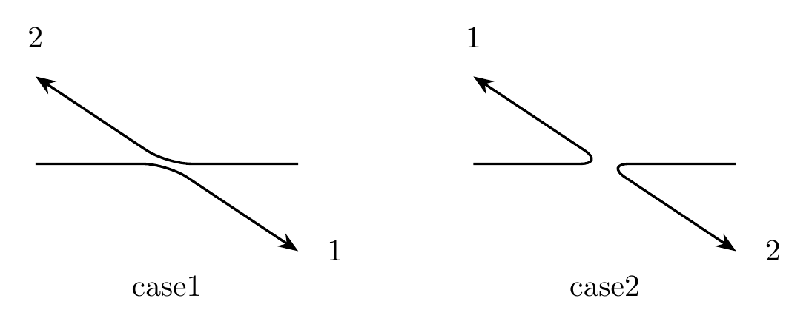

## Identical Particles and Exchange Symmetry: Overview and Plan

In classical mechanics, particles can be distinguished by following their trajectories. In quantum mechanics, however, **identical particles are fundamentally indistinguishable**. Exchanging two identical particles cannot produce a physically different situation.

This simple requirement has profound consequences. The wavefunction of a system of identical particles must have a definite symmetry under particle exchange: it is **symmetric for bosons** and **antisymmetric for fermions**. These symmetry properties determine which quantum states are allowed and give rise to phenomena such as the Pauli exclusion principle and exchange effects in multielectron atoms.

In this chapter, we will:

1. Understand why identical particles require a different description from distinguishable particles.
2. Introduce the **exchange operator** and construct symmetric and antisymmetric two-particle states.
3. Discuss the connection between **spin and exchange symmetry**, distinguishing bosons from fermions.
4. Derive the **Pauli exclusion principle** from the antisymmetry of fermionic states.
5. Establish the connection between exchange symmetry and the structure of multielectron atoms.

The central point is that **exchange is not an additional physical force**. Rather, the symmetry requirements imposed on identical particles have observable consequences for their allowed states and energies.


---


## 2.11.1. Indistinguishability of Identical Particles

In quantum mechanics, **identical particles** cannot be distinguished from one another, even in principle. If we exchange two identical particles, there is no way—either in theory or in experiment—to tell that anything has changed. This simple idea has deep implications for how we describe many-particle systems.

---

### 2.11.1.1 Product States and Indistinguishability

Suppose particle 1 (with coordinate $\vec{r}_1$) is in state $\psi_a$,  
and particle 2 (with coordinate $\vec{r}_2$) is in state $\psi_b$.

If we ignore spin for now, a naive approach would be to write the total wavefunction as a **product** of single-particle wavefunctions:

$$
\Psi(\vec{r}_1, \vec{r}_2) = \psi_a(\vec{r}_1)\, \psi_b(\vec{r}_2).
$$

> **Note of caution:**  
> In general, two-particle states cannot always be written as simple products.  
> Such *product states* are only a useful starting point for understanding the basic symmetry properties.

This expression assumes we can tell which particle is “particle 1” and which is “particle 2.” That assumption is fine in **classical mechanics**, where particles follow well-defined trajectories. But in **quantum mechanics**, identical particles have no individual identity — exchanging them cannot lead to a physically new state.

---


### 2.11.1.2. Example: Scattering of Indistinguishable Particles

Exchange symmetry becomes particularly important when identical particles occupy overlapping quantum states or when their possible final states cannot be distinguished experimentally.

Consider two identical particles scattering from one another. Classically, we could imagine two possibilities:

- **Case 1:** Particle 1 is deflected to the right and particle 2 to the left.
- **Case 2:** Particle 1 is deflected to the left and particle 2 to the right.


```{python}
#| echo: false
# eval: false
import subprocess
import os

# Determine the null device based on the operating system
null_device = "NUL" if os.name == "nt" else "/dev/null"

# Write the LaTeX code to a temporary file
latex_code = r"""
\documentclass[tikz, border=2mm]{standalone}
\usepackage{tikz-feynman}
\tikzfeynmanset{compat=1.1.0}
\usepackage{physics}


\begin{document}

\tikzset{>=latex} % for LaTeX arrow head
\usetikzlibrary{angles,quotes} % for pic

\begin{tikzpicture}[>=Stealth]
  % Bent arrow
  \draw[->, thick, rounded corners=8pt] 
    (0,0) -- (1.5,0) -- (3,-1)  node[right=+0.2] {$1$};
  \draw[->, thick, rounded corners=8pt] 
    (3,0) -- (1.5,0) -- (0,1)  node[left=-0.2, above=+.2] {$2$};
  \draw[->, thick, rounded corners=8pt] 
    (5,0) -- (6.5,0) -- (5,1)   node[left=-0.2, above=+.2] {$1$};
  \draw[->, thick, rounded corners=8pt] 
    (8,0) -- (6.5,0) -- (8,-1)  node[right=+0.2] {$2$};
  \node at (1.5,-1.4) {$\mathrm{case 1}$};
  \node at (6.5,-1.4) {$\mathrm{case 2}$};


\end{tikzpicture}
\end{document}
"""

with open("diagram.tex", "w") as f:
    f.write(latex_code)

import re

def scale_svg(file_path, factor):
    """
    Reads an SVG file and scales its width and height attributes.
    """
    with open(file_path, 'r') as f:
        content = f.read()
    
    # Define a function to perform the scaling on matched values
    def scale_match(match):
        value = float(match.group(2)) # Fix: changed from group(1) to group(2)
        new_value = value * factor
        return f'{match.group(1)}="{new_value:.3f}{match.group(3)}"'
        
    # Regex to find width="[number]pt" and height="[number]pt"
    # and replace them with the scaled value
    scaled_content = re.sub(r'(width|height)="([\d.]+)(pt|px)?"', scale_match, content)

    with open(file_path, 'w') as f:
        f.write(scaled_content)

# Define the list of diagram names
diagram_names = ["exch_scat"]

# Run the commands, redirecting all output to the null device
with open(os.devnull, 'w') as FNULL:
    # Compile the LaTeX file to PDF
    subprocess.run(["pdflatex", "-interaction=nonstopmode", "diagram.tex"], stdout=FNULL, stderr=FNULL)

    # Convert the PDF pages to SVG
    # Use a loop to process each diagram
    for i, name in enumerate(diagram_names):
        page_number = i + 1
        output_svg = f"{name}.svg"
        
        # Convert the PDF page to a specific SVG file
        # subprocess.run(["pdf2svg", "diagram.pdf", output_svg, str(page_number)], stdout=FNULL, stderr=FNULL)        
        # Scale the newly created SVG file
        # scale_svg(output_svg, 1.5)
        subprocess.run(["pdftoppm", "-f", str(page_number), "-l", str(page_number), "-singlefile", "-png", "-r", "300", "diagram.pdf", name], stdout=FNULL, stderr=FNULL)

    # Clean up temporary files
    subprocess.run(["rm", "diagram.tex", "diagram.pdf", "diagram.log", "diagram.aux"], stdout=FNULL, stderr=FNULL)
```
{fig-alt="Exchange in scattering pathways." fig-align="center" width=70%}  

For identical particles, however, the labels "1" and "2" do not represent physically distinguishable identities. If the particles emerge into the same pair of outgoing states, the two assignments cannot be distinguished.

The quantum-mechanical description must therefore account for both possibilities in a single two-particle state. Depending on the type of particle, the corresponding amplitudes enter with a plus or minus sign.

This is a consequence of **exchange symmetry**, which we will develop in the following section.

An important practical distinction is that exchange effects are usually negligible when identical particles are spatially well separated and their wavefunctions have negligible overlap. In that limit, they can often be treated as effectively distinguishable. When their quantum states overlap, or when alternative particle assignments cannot be distinguished, exchange symmetry can have observable consequences.

---

## 2.11.2. Exchange

In quantum mechanics, if we exchange two **identical particles**, the system must end up in the **same physical state**. However, the wavefunction itself may change by a *phase factor*.

Mathematically, this is captured by introducing an operator that performs the exchange explicitly.

---

### 2.11.2.1 The Exchange Operator

We define the **permutation (or exchange) operator** $P_{12}$, which swaps the coordinates of the two particles:

$$
P_{12}\,|\vec{r}_1, \vec{r}_2\rangle = |\vec{r}_2, \vec{r}_1\rangle.
$$

If the particles have additional quantum numbers (such as spin, magnetic quantum number, etc.), the operator also swaps those quantities.

Because exchanging twice returns the system to its original configuration, the operator satisfies:

$$
P_{12}^2 = \hat{I}.
$$

Moreover, since the Hamiltonian $\hat{H}$ of a system of identical particles does not depend on labeling, the exchange operator commutes with it:

$$
[P_{12}, \hat{H}] = 0.
$$

This means that we can find states that are **simultaneous eigenstates** of both $\hat{H}$ and $P_{12}$. The eigenvalues of $P_{12}$ can only be $\pm 1$:

$$
P_{12}\Psi(\vec{r}_1, \vec{r}_2) =
\begin{cases}
+\Psi(\vec{r}_1, \vec{r}_2), & \text{for symmetric wavefunctions}, \\
-\Psi(\vec{r}_1, \vec{r}_2), & \text{for antisymmetric wavefunctions.}
\end{cases}
$$

These two possibilities correspond to two fundamentally different kinds of particles.

---

### 2.11.2.2 Symmetrized and Antisymmetrized States

For two identical particles, we cannot meaningfully assign labels “1” and “2.” The wavefunction must reflect this symmetry by being either **symmetric** or **antisymmetric** under exchange.

We can construct the two possibilities as follows:

$$
\Psi_+(\vec{r}_1, \vec{r}_2)
= A \big[\, \psi_a(\vec{r}_1)\psi_b(\vec{r}_2)
+ \psi_b(\vec{r}_1)\psi_a(\vec{r}_2) \big],
$$

$$
\Psi_-(\vec{r}_1, \vec{r}_2)
= A \big[\, \psi_a(\vec{r}_1)\psi_b(\vec{r}_2)
- \psi_b(\vec{r}_1)\psi_a(\vec{r}_2) \big],
$$

where $A$ is a normalization constant ensuring that $\int |\Psi|^2 \, d^3r_1\, d^3r_2 = 1$.

- $\Psi_+$ is **symmetric**: exchanging the two particles leaves it unchanged.  
- $\Psi_-$ is **antisymmetric**: exchanging the two particles changes its sign.

---

### 2.11.2.3 Spin and Statistics

In non-relativistic quantum mechanics, we take as an **axiom** the following rule:

:::{.callout-tip title="Spin–statistics"}


- Particles with **integer spin** are **bosons**, and their total wavefunction is **symmetric** under exchange.  
- Particles with **half-integer spin** are **fermions**, and their total wavefunction is **antisymmetric** under exchange.

::: 

This fundamental connection between spin and exchange symmetry is a consequence of the **spin–statistics theorem**, a deep result from relativistic quantum field theory. For our purposes, we take it as an experimentally verified fact.

---

### 2.11.2.4 The Pauli Exclusion Principle

Let’s consider two identical fermions that try to occupy the *same* one-particle state $\psi_a$:

$$
\Psi_-(\vec{r}_1, \vec{r}_2)
= A\big[\psi_a(\vec{r}_1)\psi_a(\vec{r}_2)
- \psi_a(\vec{r}_1)\psi_a(\vec{r}_2)\big] = 0.
$$

The antisymmetric wavefunction **vanishes identically**, meaning that such a configuration is **forbidden**.  
This is the **Pauli exclusion principle**:

:::{.callout-tip title="Pauli Exclusion Principle"}

No two fermions can occupy the same quantum state.

:::

This principle explains the structure of the periodic table, the stability of matter, and the behavior of electrons in solids.

---

## 2.11.3. Generalization Beyond Coordinates

So far, we have discussed the exchange operation in **coordinate space**, where $P_{12}$ swaps the position arguments $\vec{r}_1$ and $\vec{r}_2$. However, the same idea applies much more generally: a *quantum state* can be labeled by any set of quantum numbers — such as energy level, orbital angular momentum, spin projection, etc.

In this abstract formulation, the exchange operator acts by swapping the complete sets of quantum numbers associated with the two identical particles:

$$
P_{12}\,|1\rangle_1 |2\rangle_2 = |2\rangle_1 |1\rangle_2,
$$

where the numbers in the kets refer to one-particle states (for example, different orbitals), and the subscripts denote which particle is in that state.  

The physical requirement is exactly the same as before: **exchanging two identical particles must not produce a new physical situation**. Therefore, the total two-particle state must either remain unchanged or change sign under this operation, corresponding to **bosons** and **fermions**, respectively.

> In other words, the coordinate-space wavefunctions $\Psi(\vec{r}_1, \vec{r}_2)$ are just one particular representation of this more general principle.

---

## 2.11.4. Summary

| Property | Bosons | Fermions |
|-----------|---------|-----------|
| Spin | integer | half-integer |
| Wavefunction symmetry | symmetric | antisymmetric |
| Exchange eigenvalue | $+1$ | $-1$ |
| Occupation rule | multiple particles per state | at most one per state |
| Example | photons, helium-4 atoms | electrons, protons, neutrons |

---

> **Remark:**  
> The “exchange interaction” is not a new force in the classical sense. It arises purely from the requirement that the total wavefunction be symmetric (for bosons) or antisymmetric (for fermions). Nevertheless, this *quantum exchange effect* leads to observable consequences —  such as the splitting of energy levels in helium, magnetic ordering in solids, and the formation of energy bands in metals and semiconductors.
